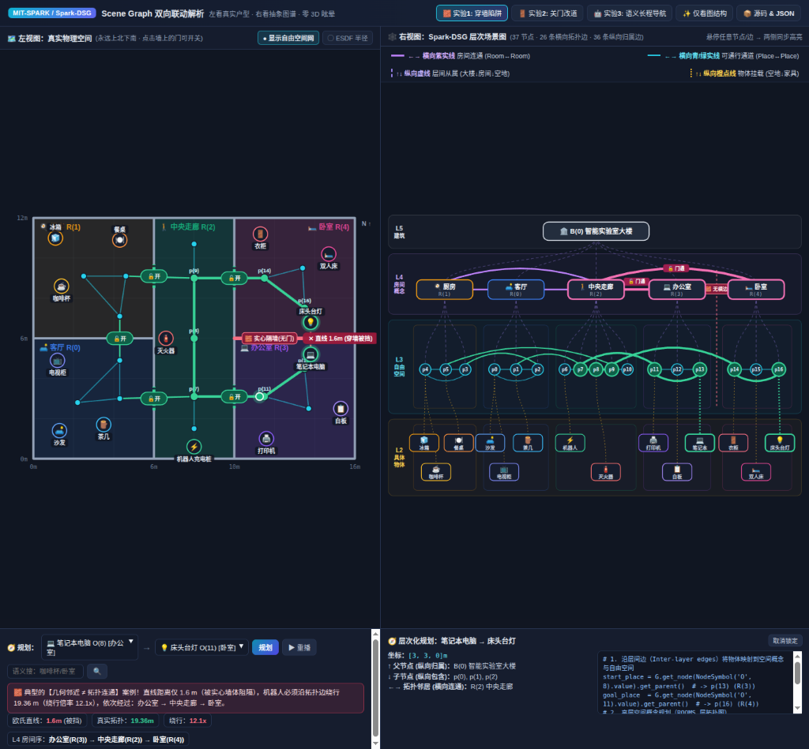
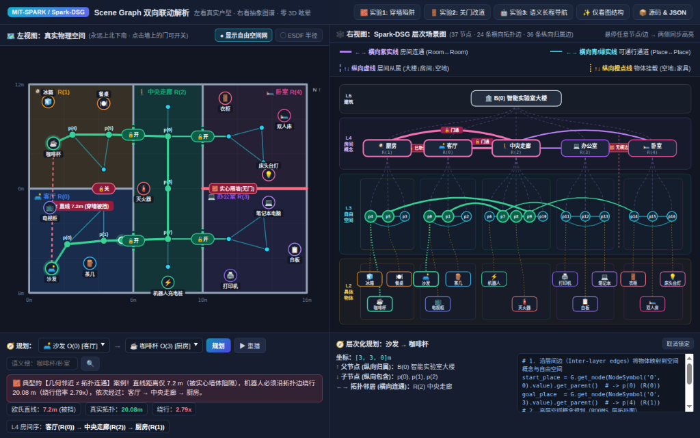

<div align="center">

# 🕸️ Spark-DSG Interactive Scene Graph Demo

**A zero-3D-dizziness Linked Dual-View WebUI for intuitively understanding 3D Scene Graphs, Spatial Concepts, and Topological Connectivity — powered live by [MIT-SPARK/Spark-DSG](https://github.com/MIT-SPARK/Spark-DSG).**

[](https://github.com/MIT-SPARK/Spark-DSG)
[](https://www.python.org/)
[](https://fastapi.tiangolo.com/)
[](#-why-linked-dual-view)

<br/>



*Left: Fixed North-Up 2D architectural floorplan with clickable doors & landmarks · Right: Orthogonal 4-layer Spark-DSG graph where **Vertical = Hierarchy (↑↓)** and **Horizontal = Topological Connectivity (←→)**.*

</div>

---

## ✨ Why Linked Dual-View?

Classic 3D exploded scene graph stacks look great as static paper hero figures, but free-orbiting 3D pancakes often cause disorientation, perspective squishing, and overlapping labels during interactive study.

This demo **decouples physical geometry from abstract graph structure** into two real-time synchronized panes:

| Pane | What You See | Mental Model |
| :--- | :--- | :--- |
| **🗺️ Left — 2D Physical Floorplan** | Always North-Up (`16m × 12m`), 5 rooms, furniture icons, solid walls, clickable `🔓开 / 🔒关` doors, optional ESDF clearance circles & animated robot | **Physical reality**: *Where are the walls, doors, and objects? Why can't the robot walk in a straight line?* |
| **🕸️ Right — Orthogonal 4-Layer Scene Graph** | 4 crisp horizontal tiers (`L5 Buildings → L4 Rooms → L3 Places → L2 Objects`) | **↑↓ Vertical dashed/dotted edges** = *Inter-layer Hierarchy (containment)*<br/>**←→ Horizontal solid edges** = *Intra-layer Topological Connectivity (traversability)* |

---

## 🎮 Interactive Experiments Showcase

<table>
  <tr>
    <th width="50%">🧱 Experiment 1: Wall Trap (Geometric ≠ Topological)</th>
    <th width="50%">🚪 Experiment 2: Live Door Toggle & Rerouting</th>
  </tr>
  <tr>
    <td>
      
    </td>
    <td>
      
    </td>
  </tr>
  <tr>
    <td>
      <code>Laptop O(8)</code> → <code>Bedside Lamp O(11)</code> are only <strong>1.6 m</strong> apart across a solid wall (<code>🧱 实心隔墙</code>), yet have <strong>zero horizontal edge</strong> between <code>R(3) Office</code> and <code>R(4) Bedroom</code>. The planner detours <strong>19.36 m (12.1×)</strong> via <code>Office → Corridor → Bedroom</code>.
    </td>
    <td>
      Click the <code>🔓开</code> doorway pill directly on the left wall to close it — the backend calls real <code>G.remove_edge()</code> on <code>spark_dsg.DynamicSceneGraph</code>. The right graph snaps to <code>🔒 已断开</code> and reroutes <code>Sofa → Coffee Mug</code> from <strong>10.73 m</strong> direct to <strong>20.08 m</strong> via the Corridor.
    </td>
  </tr>
</table>

Other built-in interactions:
- **Bidirectional Hover & Click Spotlight**: Hover or click any node or edge on either side to highlight its full vertical ancestry chain (`B → R → p → O`) and horizontal topological neighbors across both views, while inspecting the exact `spark_dsg` Python API call in the bottom dock.
- **Semantic Navigation Search**: Type an object or spatial concept (e.g. `咖啡杯`, `卧室`, `Laptop`) to resolve its hierarchy and run two-stage planning (`DsgLayers.ROOMS` macro path → `DsgLayers.PLACES` free-space Dijkstra).
- **Live DSG JSON Inspector**: Click **📦 源码 & JSON** in the header to inspect the serialized `smart_lab_dsg.json` exported via `G.save()`.

---

## 🏗️ Scene Graph Layers (`L5` → `L1`)

Following MIT's **3D Dynamic Scene Graph (Hydra / Spark-DSG)** hierarchy:

| Layer | `spark_dsg` Layer | Role in the Graph |
| :--- | :--- | :--- |
| **L5** | `DsgLayers.BUILDINGS` | Top-level **Spatial Concept** grouping rooms/floors into a building (`B(0)`) |
| **L4** | `DsgLayers.ROOMS` | Room-level **Spatial Concepts** (`R(0)–R(4)`) with horizontal edges encoding room-to-room doorway connectivity |
| **L3** | `DsgLayers.PLACES` | Traversable free-space nodes (`p(0)–p(16)`) with ESDF obstacle clearance radius; backbone for collision-free path planning |
| **L2** | `DsgLayers.OBJECTS` *(+ `AGENTS`)* | Concrete 3D semantic objects (`O(0)–O(13)`) with bounding boxes, mounted vertically to their nearest `Place` |
| *(Underlying)* **L1** | `Mesh` / `SEGMENTS` | Dense metric-semantic 3D geometry & pre-object segments (represented here by the left 2D architectural floorplan) |

---

## 🚀 Quick Start

```bash
git clone https://github.com/WarriorHanamy/spark-dsg-interactive-demo.git
cd spark-dsg-interactive-demo

python3 -m venv .venv
source .venv/bin/activate
pip install -r requirements.txt

# (Optional) Regenerate data/smart_lab_dsg.json using spark_dsg
python build_scene_graph.py

# Launch the interactive WebUI
uvicorn server:app --host 127.0.0.1 --port 8765
```

Open **[http://127.0.0.1:8765](http://127.0.0.1:8765)** in your browser.

---

## 📁 Project Structure

```text
.
├── assets/
│   ├── demo-wall-trap.png       # Experiment 1 hero screenshot
│   └── demo-door-reroute.png    # Experiment 2 dynamic door-close screenshot
├── data/
│   └── smart_lab_dsg.json       # Real Spark-DSG JSON exported via G.save()
├── static/
│   └── index.html               # Zero-CDN Linked Dual-View SVG WebUI
├── build_scene_graph.py         # Builds the 4-layer DynamicSceneGraph (37 nodes, 62 edges)
├── server.py                    # FastAPI server (live graph mutations, hierarchical Dijkstra, query)
└── requirements.txt
```

## 🙏 Credits

Built directly on top of **[MIT-SPARK/Spark-DSG](https://github.com/MIT-SPARK/Spark-DSG)** by MIT SPARK Lab.
